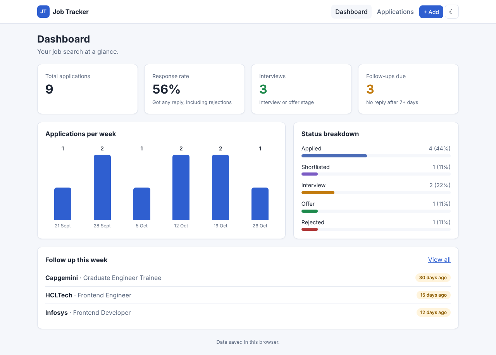
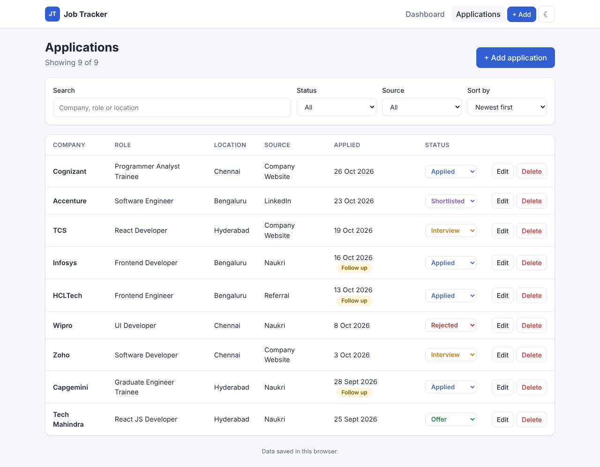
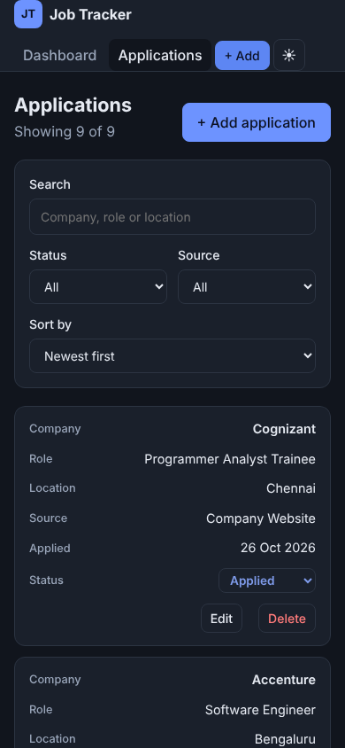

# Job Application Tracker

A responsive React web app to track job applications, see response rates, and get reminders to follow up with companies that haven't replied.

I built it to organise my own job search: instead of a messy spreadsheet, every application has a status, and the dashboard shows what is working and what needs a follow-up.

**Live demo:** _add your Vercel link here after deploying_



## Features

- **Add, edit and delete applications:** company, role, location, job link, source, applied date and notes
- **Status pipeline:** Applied → Shortlisted → Interview → Offer / Rejected, changed inline from the table
- **Search, filter and sort:** by company, role, location, status, source and date
- **Dashboard:** total applications, response rate, interviews, follow-ups due, a weekly applications chart and a status breakdown
- **Follow-up reminders:** highlights applications with no reply after 7 days
- **Form validation:** required fields, no future dates, valid URLs, with accessible error messages
- **Responsive design:** the table turns into cards on mobile
- **Dark mode:** follows the system setting and remembers your choice
- **Two storage modes:** works fully in the browser (localStorage), or with the Flask REST API when `VITE_API_URL` is set

| Applications | Mobile (dark mode) |
| --- | --- |
|  |  |

## Tech stack

| Layer | Tools |
| --- | --- |
| Frontend | React 18, JavaScript (ES6+), React Router, Context API + useReducer, CSS3 (Flexbox, Grid, media queries, custom properties) |
| Backend | Python, Flask, SQLite, REST API |
| Testing | Vitest (frontend logic), Pytest (API) |
| Deployment | Vercel (frontend), Render (backend) |

## Project structure

```
job-application-tracker/
├── frontend/
│   ├── src/
│   │   ├── components/   # Reusable UI: table, form, filters, charts, cards
│   │   ├── pages/        # Dashboard, Applications, Add, Edit, Not found
│   │   ├── context/      # Global state with Context API + useReducer
│   │   ├── services/     # Data layer: REST API or localStorage
│   │   ├── hooks/        # useTheme (dark mode)
│   │   └── utils/        # Stats, filters, validation (+ unit tests)
│   └── package.json
└── backend/
    ├── app.py            # Flask REST API
    ├── test_app.py       # API tests
    └── requirements.txt
```

## Run locally

**Requirements:** Node.js 18+, Python 3.10+

### Frontend only (data saved in the browser)

```bash
cd frontend
npm install
npm run dev
```

Open http://localhost:5173

### With the backend API

```bash
# Terminal 1: backend
cd backend
python -m venv venv
venv\Scripts\activate          # Windows  (macOS/Linux: source venv/bin/activate)
pip install -r requirements.txt
python app.py                  # runs on http://localhost:5000

# Terminal 2: frontend
cd frontend
copy .env.example .env         # macOS/Linux: cp .env.example .env
npm run dev
```

### Run tests

```bash
cd frontend && npm test
cd backend && pytest
```

## REST API

| Method | Endpoint | Description |
| --- | --- | --- |
| GET | `/api/applications` | List all applications |
| GET | `/api/applications/:id` | Get one application |
| POST | `/api/applications` | Create an application |
| PUT | `/api/applications/:id` | Update an application |
| DELETE | `/api/applications/:id` | Delete an application |
| GET | `/api/health` | Health check |

Invalid input returns `400` with field-level error details, for example:

```json
{ "error": "Validation failed.", "details": { "company": "Company name is required." } }
```

## Deployment

- **Frontend (Vercel):** import the repo, set the root directory to `frontend`, and deploy. Leave `VITE_API_URL` empty for browser storage, or set it to your backend URL.
- **Backend (Render):** create a Web Service with root directory `backend`, build command `pip install -r requirements.txt`, start command `gunicorn app:app`, and set `ALLOWED_ORIGIN` to your Vercel URL.
  Note: on Render's free plan the SQLite file resets when the service restarts. For permanent data, switch to a hosted PostgreSQL database.

## Planned improvements

- Drag-and-drop Kanban board for statuses
- Login with JWT so each user sees only their own data
- Export applications to CSV
- Component tests with React Testing Library

## Author

**Pranathi Bestha**
[LinkedIn](https://linkedin.com/in/pranathi-bestha-456a0b29a) · [GitHub](https://github.com/pranathibestha)
